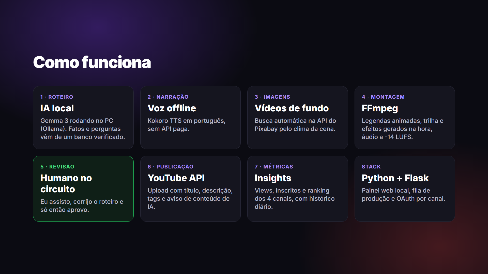
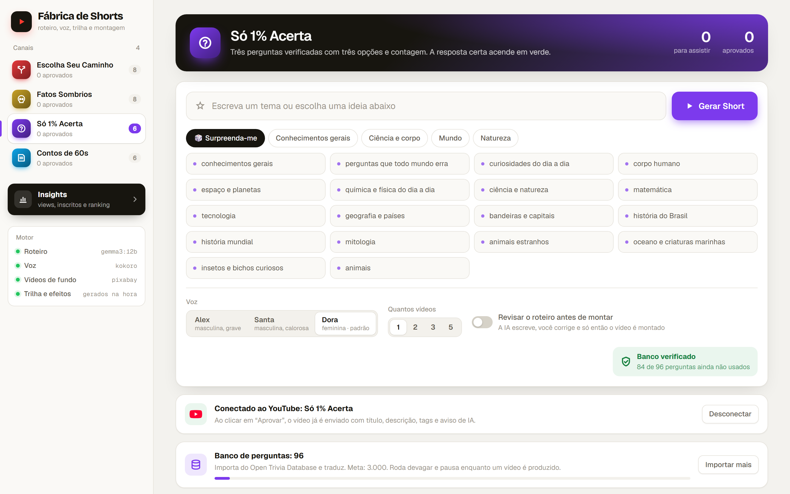
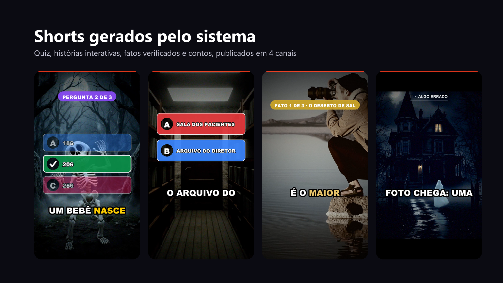
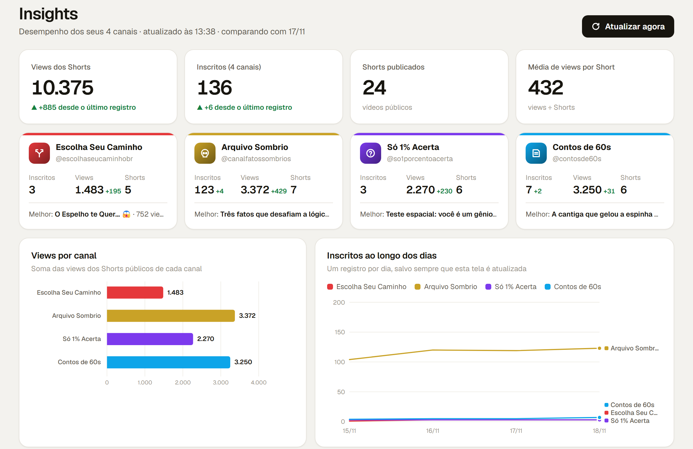

# 🎬 Fábrica de Shorts

**Um sistema que produz e publica YouTube Shorts de ponta a ponta, com IA rodando no próprio PC.**

Ele escreve o roteiro, narra, busca os vídeos de fundo, monta tudo com legenda e trilha e publica no YouTube. Antes de qualquer vídeo ir ao ar, um humano revisa e aprova.

## O que ele faz

| Etapa | Como |
|---|---|
| **Roteiro** | IA local (Gemma 3 ou Qwen 2.5 via [Ollama](https://ollama.com)). Nos formatos de quiz e de fatos, o conteúdo vem de **bancos verificados**, com checagem de números contra alucinação. |
| **Narração** | Voz em português gerada offline com [Kokoro TTS](https://github.com/thewh1teagle/kokoro-onnx) (ONNX). |
| **Imagens** | Busca de vídeos de fundo na API do [Pixabay](https://pixabay.com/api/docs/) de acordo com o clima da cena. |
| **Montagem** | FFmpeg: legendas animadas, cartões de quiz, trilha e efeitos sonoros gerados na hora (NumPy) e áudio normalizado em -14 LUFS. |
| **Revisão** | Painel web para ler e corrigir o roteiro, assistir e aprovar ou descartar. |
| **Publicação** | YouTube Data API v3, com OAuth separado por canal e o aviso de conteúdo alterado ou sintético marcado. |
| **Insights** | Views, inscritos e ranking dos vídeos de cada canal, com histórico diário. |

São 4 formatos prontos: **Escolha Seu Caminho** (histórias interativas A/B), **Fatos Sombrios** (3 fatos verificados), **Só 1% Acerta** (quiz com contagem regressiva) e **Contos de 60s**.

| Painel | Shorts gerados |
|---|---|
|  |  |

## Rodar

No **Windows**, em um clique:

1. Dê dois cliques em `instalar.bat`. Ele instala Python 3.12, FFmpeg, Ollama e o Visual C++, prepara as bibliotecas, baixa a voz e o modelo de IA.
2. Dê dois cliques em `iniciar.bat`. O painel abre em `localhost:5050`.

O passo a passo completo está no [`GUIA.md`](GUIA.md). Ele cobre a chave do Pixabay, a configuração do Google Cloud para enviar ao YouTube e a solução de problemas.

Em outros sistemas: Python 3.12, `pip install -r requirements.txt`, FFmpeg no PATH, Ollama com `gemma3:12b` ou `qwen2.5:7b`, os arquivos do Kokoro em `modelos/` e `python painel.py`.

## ⚠️ Aviso importante: as regras do YouTube

Eu testei o sistema com 4 canais novos. Em poucos dias foram mais de 30 Shorts e mais de 10 mil views, mas **3 dos 4 canais foram removidos pelo YouTube** por violar as Diretrizes da Comunidade. O mais provável é a política de spam e conteúdo repetitivo. Só o canal antigo, com histórico, sobreviveu.

Se for usar:

- **Comece devagar.** Canal novo com vários vídeos por dia, todos no mesmo formato e enviados por API, é exatamente o padrão que os filtros procuram.
- **Não crie vários canais novos de uma vez** na mesma conta Google.
- **Varie o conteúdo** e revise de verdade cada vídeo antes de aprovar.
- **Monetização** depende das regras do YouTube Partner Program, que recusa conteúdo produzido em massa ou repetitivo.

Este projeto é um estudo de automação e IA aplicada. Use por sua conta e risco.

## Stack

Python · Flask · Ollama (Gemma 3 / Qwen 2.5) · Kokoro TTS / ONNX Runtime · FFmpeg · Pillow · NumPy · YouTube Data API v3 · OAuth 2.0 · Pixabay API

Os componentes de terceiros e as licenças deles estão em [`TERCEIROS.md`](TERCEIROS.md).

## Licença

Código aberto sob a [licença MIT](LICENSE).
